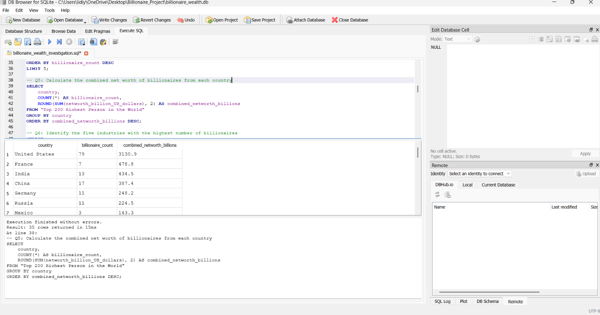
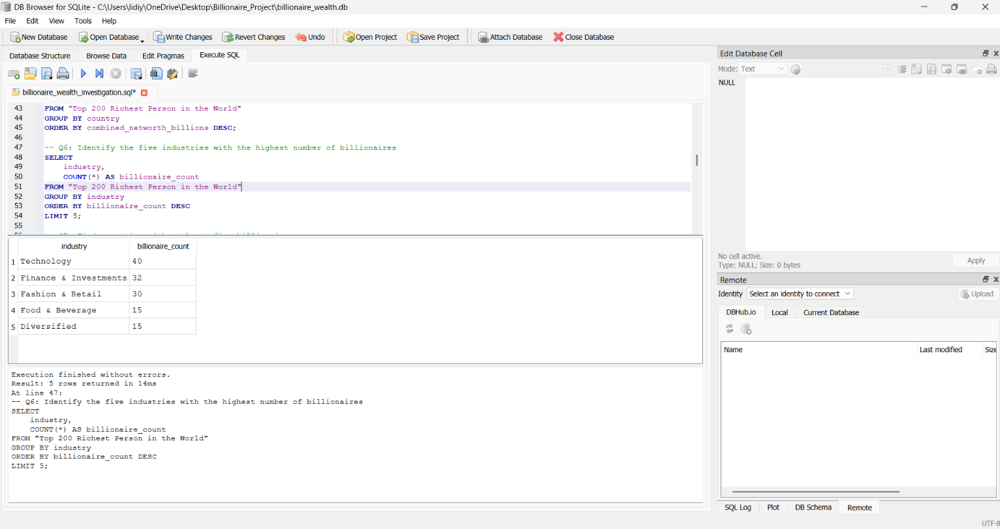

# 💰 SQL Project: The Billionaire Wealth Investigation

## 📌 Business Scenario
Acting as a Junior Data Analyst for a global financial research organisation, this project investigates wealth distribution, geographic concentration, age demographics, and industry dominance among the world's Top 200 Richest Billionaires (Forbes list) using SQLite.

---

## 📂 Repository Contents
* [billionaire_wealth_investigation.sql](billionaire_wealth_investigation.sql) — Complete SQL script solving all 10 business questions from the investigation brief plus generational segmentation and window-function queries.
* [Top 200 Richest Person in the World.csv](Top%20200%20Richest%20Person%20in%20the%20World.csv) — Forbes Top 200 Billionaires dataset (serial_number, rank, name, age, country, networth_billion_US_dollars, industry).
* country_wealth.png & top_industries.png — SQL query execution previews from DB Browser for SQLite.

---

## 🧹 Data Cleaning & Preparation
An initial audit revealed trailing and leading whitespace inconsistencies in the country column ("China " and " Brazil"), which would have fragmented country-level groupings. All text fields were standardized using TRIM() via an UPDATE statement prior to running aggregations.

---

## 📊 Business Questions & Analytical Findings (Q1–Q10)

| # | Business Question | Key Analytical Result |
| :--- | :--- | :--- |
| 1 | Retrieve the 20 richest billionaires | Led by Bernard Arnault & family ($233B), Elon Musk ($195B), and Jeff Bezos ($194B); Jensen Huang ($77B) holds the #20 spot. |
| 2 | Identify the five youngest billionaires | Mark Mateschitz (31, $39.6B) is youngest, followed by Lukas Walton (37, $28B) and three 39-year-olds: Mark Zuckerberg ($177B), Dustin Moskovitz ($18.3B), and Pavel Durov ($15.5B). |
| 3 | Calculate average age & average net worth | Average age is 69.4 years; average net worth is $31.84 billion (combined top-200 wealth: $6,368.5 billion). |
| 4 | Identify the five most represented countries | United States (79), China (19), India (13), Germany (11), and Russia (10). |
| 5 | Combined net worth by country | United States leads with $3,130.9B (~49.2% of total wealth), followed by France ($478.8B) and India ($434.5B). |
| 6 | Top five industries by billionaire count | Technology (40), Fashion & Retail (30), Finance & Investments (30), Food & Beverage (14), and Diversified (13). |
| 7 | Find countries with at least five billionaires | 9 countries meet this threshold: US (79), China (19), India (13), Germany (11), Russia (10), Hong Kong (8), France (7), Australia (5), and UK (5). |
| 8 | Total wealth of billionaires younger than 50 | 13 billionaires under age 50 hold a combined net worth of $627.8 billion. |
| 9 | Billionaires exceeding overall average net worth | 51 out of 200 billionaires exceed the $31.84B average, showing steep right-skewed wealth concentration at the top. |
| 10 | Industry with the highest average net worth | Telecom ranks #1 ($102.0B average, represented by Carlos Slim Helu & family), followed by Technology ($43.47B). |

---

## 💡 Deeper Executive Insights Uncovered
* Extreme Top-End Skew: Only 25.5% of the top 200 billionaires (51 individuals) sit above the mean net worth ($31.84B), pulled upward by the 14 centibillionaires ($100B+).
* Technology Fuels Youth Wealth: Among the 13 billionaires under age 50, Technology founders hold the vast majority of wealth, led by Mark Zuckerberg ($177B) and Zhang Yiming ($43.4B).
* Geographic Superpower Concentration: Over 70% of the world's top 200 billionaires reside in just 9 countries, with the United States alone controlling nearly half of all combined net worth.

---
### Combined Net Worth by Country (Q5)

### Top Industries by Billionaire Count (Q6)

---

## 🛠️ SQL Techniques Demonstrated
UPDATE • TRIM() • COUNT() • SUM() • AVG() • GROUP BY • HAVING • CASE WHEN • Scalar Subqueries • Common Table Expressions (WITH) • Window Functions (RANK() OVER PARTITION BY)

## 📸 Query Execution Previews

